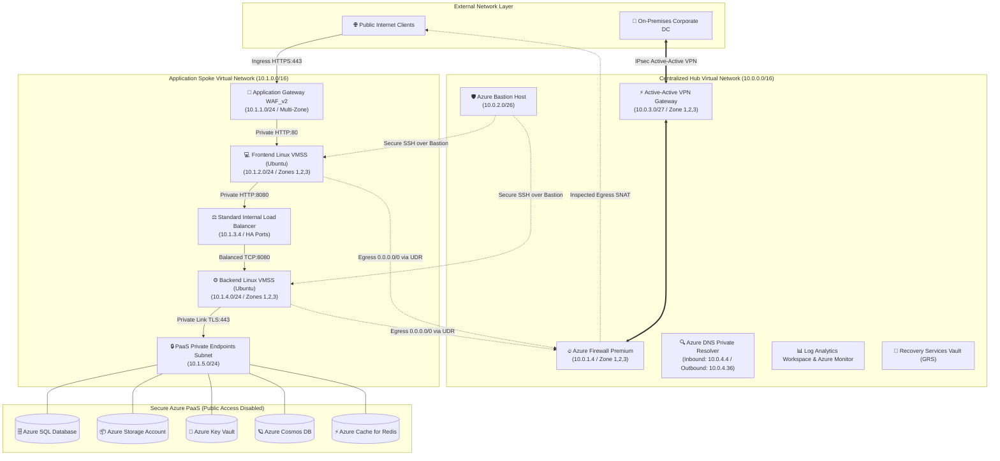
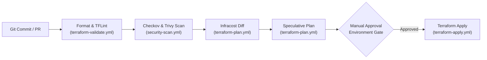

# Enterprise Azure Hub-and-Spoke High Availability Landing Zone

[](https://www.terraform.io/)
[](https://registry.terraform.io/providers/hashicorp/azurerm/latest)
[](docs/architecture.md)
[](docs/security-design.md)
[](.github/workflows/security-scan.yml)
[](LICENSE)

Production-ready, highly available, multi-zone **Enterprise Azure Landing Zone** built using a modular **Hub-and-Spoke** topology with **Terraform (AzureRM 4.x)**.

This repository implements the Microsoft Cloud Adoption Framework (CAF) and Azure Well-Architected Framework principles, delivering zero-trust perimeter network security, centralized egress inspection, private-only compute workloads, multi-tier load balancing, PaaS private endpoints, and automated CI/CD governance.

---

## Table of Contents

- [Architectural Overview](#architectural-overview)
- [System Architecture Diagram](#system-architecture-diagram)
- [Key Enterprise Features](#key-enterprise-features)
- [Technology Stack](#technology-stack)
- [Repository Structure](#repository-structure)
- [Terraform Module Catalog](#terraform-module-catalog)
- [Environment Matrix](#environment-matrix)
- [Data Flow & Traffic Inspection](#data-flow--traffic-inspection)
- [Quick Start Guide](#quick-start-guide)
  - [Prerequisites](#prerequisites)
  - [Step 1: Bootstrap State Backend](#step-1-bootstrap-state-backend)
  - [Step 2: Deploy Environment](#step-2-deploy-environment)
  - [Automation Scripts](#automation-scripts)
- [DevSecOps, CI/CD & Quality Gates](#devsecops-cicd--quality-gates)
- [Operational Runbook & Day-2 Management](#operational-runbook--day-2-management)
- [Technical Documentation Index](#technical-documentation-index)
- [License](#license)

---

## Architectural Overview

The infrastructure establishes a strict separation of concerns between shared platform services and application workloads:

1. **Centralized Hub Virtual Network (`10.0.0.0/16`)**:
   - **Azure Firewall Premium**: Centralized, zone-redundant next-generation firewall inspecting all north-south internet egress and east-west inter-spoke traffic with TLS termination, IDPS, and URL filtering.
   - **Azure Bastion Host**: Zone-redundant, browser-based secure administration gateway for private Linux VMs (zero public IPs on compute instances).
   - **Active-Active Site-to-Site VPN Gateway**: Multi-zone IPsec VPN gateway for fault-tolerant hybrid cloud connectivity with optional BGP routing.
   - **Azure DNS Private Resolver**: Hybrid DNS resolution hub integrating on-premises DNS forwarders with Azure Private DNS zones.
   - **Centralized Shared Observability**: Azure Log Analytics Workspace, Azure Monitor, and Azure Recovery Services Vault (GRS).

2. **Isolated Application Spoke Virtual Network (`10.1.0.0/16`)**:
   - **Application Gateway WAF_v2 (`10.1.1.0/24`)**: Zone-redundant public ingress controller with OWASP Core Rule Set in Prevention mode, autoscaling, and TLS offloading.
   - **Frontend Linux Tier (`10.1.2.0/24`)**: Ubuntu Linux Virtual Machine Scale Set (VMSS) distributed across Availability Zones (1, 2, 3), private-only networking, and automatic horizontal scaling.
   - **Standard Internal Load Balancer (`10.1.3.0/24`)**: Zone-redundant internal layer-4 load balancer distributing private API traffic from frontend to backend.
   - **Backend Linux Tier (`10.1.4.0/24`)**: Private Ubuntu Linux VMSS distributed across Availability Zones, shielded from public networks.
   - **PaaS Private Endpoint Subnet (`10.1.5.0/24`)**: Dedicated private IP endpoints and Private DNS Zone groups for managed Azure PaaS data stores.

3. **Secure Azure PaaS Layer (Private Link Only)**:
   - **Azure SQL Database**: Transparent Data Encryption (TDE), Entra ID authentication, TLS 1.2+, and public access disabled.
   - **Azure Blob Storage**: Secure TLS 1.2 storage account with GRS/ZRS replication, container lifecycle management, and public network access disabled.
   - **Azure Key Vault**: Hardware-backed secrets, certificates, and encryption keys with Azure RBAC and purge protection.
   - **Azure Cosmos DB**: Multi-model NoSQL database configured exclusively with Private Endpoint connectivity.
   - **Azure Cache for Redis**: Distributed in-memory cache accessible only via internal private IPs.

---

## System Architecture Diagram



---

## Key Enterprise Features

- **True Multi-Zone Resilience**: Every tier (Firewall, VPN Gateway, Application Gateway, VMSS compute, Load Balancers, and PaaS) is deployed with multi-zone availability (`zones = ["1", "2", "3"]`) for 99.99% infrastructure uptime SLA.
- **Zero-Trust Network Segmentation**:
  - No public IP addresses are assigned to individual virtual machines.
  - Subnet micro-segmentation enforced by Network Security Groups (NSGs) with default-deny rules.
  - Forced egress tunneling (`0.0.0.0/0 -> 10.0.1.4`) via custom User Defined Routes (UDRs) directing all outbound traffic to Azure Firewall.
- **Dynamic Declarative HCL Architecture**:
  - Modules and environments utilize advanced `for_each` over **nested maps**, decoupling structural infrastructure definitions from configuration values.
  - All configurable parameters reside cleanly in `terraform.tfvars`.
- **Private DNS Auto-Resolution**: Centralized Private DNS Zones automatically linked to Hub and Spoke VNets with Private DNS Resolver endpoints for hybrid on-premises query forwarding.
- **Enterprise DevSecOps Automation**: Automated CI/CD GitHub Actions pipelines featuring pre-commit linting (`tflint`), static security auditing (`checkov`), cost projection (`infracost`), and multi-environment apply gates.
- **Unified Observability & Auditability**: Centralized diagnostic settings streaming all resource metrics, access logs, and firewall audit trails to Azure Log Analytics.

---

## Technology Stack

| Domain | Technology / Service | Specification / Version |
| :--- | :--- | :--- |
| **Cloud Provider** | Microsoft Azure | Global Azure Cloud |
| **Infrastructure as Code** | HashiCorp Terraform | `>= 1.9.0` |
| **Terraform Provider** | `hashicorp/azurerm` | `~> 4.0` (AzureRM 4.x native) |
| **Operating System** | Canonical Ubuntu Server | `22_04-lts-gen2` |
| **Perimeter Security** | Azure Firewall | `Premium` tier (IDPS, TLS, Threat Intel) |
| **Ingress Controller** | Azure Application Gateway | `WAF_v2` (OWASP CRS 3.2 in Prevention Mode) |
| **Remote Access** | Azure Bastion | `Standard` tier (Multi-Zone) |
| **Hybrid Connectivity** | Azure VPN Gateway | `VpnGw2AZ` (Active-Active, Route-based) |
| **Compute Workloads** | Azure VMSS | Linux Virtual Machine Scale Sets with Autoscaling |
| **Internal Load Balancing**| Azure Load Balancer | Standard SKU, Zone-redundant, HA probe |
| **DNS Management** | Azure Private DNS & Resolver | Private DNS Zones + Inbound/Outbound Endpoints |
| **Secrets & Encryption** | Azure Key Vault | Premium SKU with Azure RBAC & Soft Delete |
| **Relational Database** | Azure SQL Database | General Purpose (vCore-based) + Private Link |
| **Object Storage** | Azure Storage Account | TLS 1.2, GRS/ZRS, Blob Private Endpoint |
| **NoSQL Database** | Azure Cosmos DB | Serverless / Provisioned with Private Link |
| **In-Memory Cache** | Azure Cache for Redis | Standard / Premium with Private Endpoint |
| **Observability** | Azure Monitor & Log Analytics | 30-90 Day Retention, Metric Alerting |
| **Data Protection** | Azure Recovery Services Vault | Daily GRS VM Backup Policies |
| **CI/CD Automation** | GitHub Actions | Automated Lint, Security Scan, Plan & Apply |
| **Static Security Scan** | Checkov & TFLint | Enforcing CIS Azure Foundations Benchmarks |
| **Cost Estimation** | Infracost | Automated PR comment with monthly delta breakdown |

---

## Repository Structure

```text
Enterprise-Azure-Landing-Zone/
│
├── .github/workflows/              # Automated CI/CD workflows
│   ├── terraform-validate.yml      # PR syntax and linting checks
│   ├── terraform-plan.yml          # Multi-environment speculative plan & Infracost
│   ├── terraform-apply.yml         # Protected manual apply pipeline
│   └── security-scan.yml           # Checkov security and compliance analysis
│
├── bootstrap/                      # Independent state storage bootstrap
│   └── terraform-backend/          # Provisions RG, GRS Storage Account, and Container
│       ├── main.tf
│       ├── variables.tf
│       ├── outputs.tf
│       └── terraform.tfvars
│
├── environments/                   # Isolated environment deployments
│   ├── dev/                        # Development environment (single-zone, scaled down)
│   │   ├── main.tf                 # Root orchestration using nested maps
│   │   ├── variables.tf
│   │   ├── outputs.tf
│   │   ├── backend.tf
│   │   └── terraform.tfvars        # Nested map values for dev
│   │
│   ├── staging/                    # Pre-production environment (multi-zone parity)
│   │   ├── main.tf
│   │   ├── variables.tf
│   │   ├── outputs.tf
│   │   ├── backend.tf
│   │   └── terraform.tfvars        # Nested map values for staging
│   │
│   └── prod/                       # Production environment (full multi-zone HA, Premium SKUs)
│       ├── main.tf
│       ├── variables.tf
│       ├── outputs.tf
│       ├── backend.tf
│       └── terraform.tfvars        # Production values with premium redundancy
│
├── modules/                        # 22 Production-grade reusable Terraform modules
│   ├── application-gateway/        # App Gateway WAF_v2, SSL termination, rewrite rules
│   ├── backup/                     # Recovery Services Vault and VM backup policies
│   ├── bastion/                    # Azure Bastion Host with multi-zone public IP
│   ├── cosmos-db/                  # Cosmos DB account and databases
│   ├── dns-resolver/               # DNS Private Resolver, Inbound/Outbound endpoints
│   ├── firewall/                   # Azure Firewall Premium, policies, rule collection groups
│   ├── internal-load-balancer/     # Standard ILB, backend pools, health probes, rules
│   ├── key-vault/                  # Key Vault with RBAC authorization and network ACLs
│   ├── linux-vmss/                 # Linux VMSS, cloud-init, autoscale settings, health probe
│   ├── monitoring/                 # Log Analytics Workspace, action groups, metric alerts
│   ├── nsg/                        # Network Security Group and security rules
│   ├── private-dns/                # Private DNS Zones and virtual network link attachments
│   ├── private-endpoint/           # Private Endpoints with DNS zone group associations
│   ├── redis/                      # Azure Cache for Redis
│   ├── resource-group/             # Azure Resource Group provisioning
│   ├── route-table/                # Route tables, custom UDRs, and subnet associations
│   ├── sql-database/               # Azure SQL Server, database, TDE, and firewall rules
│   ├── storage-account/            # Storage account, containers, lifecycle rules, TLS 1.2
│   ├── subnet/                     # Subnets with service delegation and endpoint policies
│   ├── virtual-network/            # Azure Virtual Networks and address space definitions
│   ├── vnet-peering/               # Bidirectional VNet Peering with gateway transit
│   └── vpn-gateway/                # Active-Active VPN Gateway, local network gateway, connections
│
├── global/                         # Global constants and governance definitions
│   ├── naming.tf                   # CAF-aligned naming convention generator
│   └── tags.tf                     # Mandatory organizational and FinOps tags
│
├── scripts/                        # Automated local and pipeline utility scripts
│   ├── validate.sh / .ps1          # Format, init, and validation suite
│   ├── plan.sh / .ps1              # Speculative environment plan generator
│   └── deploy.sh / .ps1            # End-to-end multi-environment deployment runner
│
├── docs/                           # Exhaustive technical architecture documentation
│   ├── architecture.md             # End-to-end architecture specification
│   ├── network-design.md           # CIDR IP plan, routing tables, and firewall policies
│   ├── security-design.md          # Zero Trust controls, RBAC, WAF, and compliance
│   ├── deployment-guide.md         # Step-by-step implementation guide
│   ├── disaster-recovery.md        # RTO/RPO targets, failover runbooks, and backups
│   └── troubleshooting.md          # Diagnostic runbooks and common error resolutions
│
├── .checkov.yaml                   # Security scanner baseline configuration
├── .tflint.hcl                     # Terraform linter rules and plugins
├── infracost.yml                   # Cloud cost estimation profile
├── LICENSE                         # Project license (MIT)
└── README.md                       # Master documentation entrypoint
```

---

## Terraform Module Catalog

Every module in `modules/` is decoupled, parameter-driven, and contains its own `main.tf`, `variables.tf`, and `outputs.tf`:

| Module | Purpose | Key AzureRM 4.x Capabilities |
| :--- | :--- | :--- |
| **`resource-group`** | Base lifecycle container | Standardized naming and resource tagging. |
| **`virtual-network`**| Software-defined network | Configurable address spaces, DNS server overrides. |
| **`subnet`** | Subnet allocation | Delegations, Private Endpoint network policies. |
| **`nsg`** | Subnet microsegmentation | Dynamic security rules, count-based subnet association. |
| **`route-table`** | Traffic routing control | Custom next-hop UDRs (`VirtualAppliance`, `Internet`). |
| **`vnet-peering`** | Inter-VNet connectivity | Gateway transit, forwarded traffic, remote gateways. |
| **`firewall`** | Centralized inspection | AzureRM 4.x Firewall Policy, Rule Collection Groups. |
| **`bastion`** | Secure management | Multi-zone Bastion host, native SSH without public IPs. |
| **`vpn-gateway`** | Hybrid S2S connectivity | Active-Active dual IP configuration, optional BGP. |
| **`dns-resolver`** | Hybrid DNS resolution | Inbound endpoints, outbound endpoints, forwarding rules. |
| **`private-dns`** | Internal PaaS resolution | Zones (`privatelink.database.windows.net`, etc.) & VNet links. |
| **`application-gateway`**| Public ingress & WAF | WAF_v2, Prevention mode, multi-zone, autoscaling, TLS. |
| **`linux-vmss`** | Compute scale sets | Ubuntu 22.04 LTS, Availability Zones, cloud-init, autoscale. |
| **`internal-load-balancer`**| Internal L4 distribution | Standard SKU, multi-zone, TCP health probes, HA ports. |
| **`private-endpoint`** | PaaS private connectivity | Sub-resource target mapping, Private DNS zone integration. |
| **`key-vault`** | Cryptographic secrets | Azure RBAC authorization, network ACLs, purge protection. |
| **`storage-account`** | Secure blob store | TLS 1.2, GRS/ZRS, container lifecycle, private endpoints. |
| **`sql-database`** | Relational database | Serverless/Provisioned vCore, TDE, TLS 1.2+, private endpoint. |
| **`cosmos-db`** | Scalable NoSQL store | Multi-region, consistency levels, private endpoint binding. |
| **`redis`** | In-memory caching | TLS enforcement, non-SSL disabled, private endpoint binding. |
| **`monitoring`** | Observability engine | Log Analytics, diagnostic settings, metric alert triggers. |
| **`backup`** | Business continuity | Recovery Services Vault, GRS backup policies, daily schedules. |

---

## Environment Matrix

The architecture scales seamlessly across stages via environment-specific `terraform.tfvars`:

| Feature / Dimension | `dev` | `staging` | `prod` |
| :--- | :--- | :--- | :--- |
| **Hub Address Space** | `10.0.0.0/16` | `10.0.0.0/16` | `10.0.0.0/16` |
| **Spoke Address Space** | `10.1.0.0/16` | `10.1.0.0/16` | `10.1.0.0/16` |
| **Firewall SKU & Tier** | Standard (`10.0.1.4`) | Premium (`10.0.1.4`) | Premium (`10.0.1.4`) |
| **Availability Zones** | Single Zone (`["1"]`) | Multi-Zone (`["1", "2"]`) | Multi-Zone (`["1", "2", "3"]`) |
| **VPN Gateway SKU** | `VpnGw1` (Active-Passive) | `VpnGw2AZ` (Active-Active) | `VpnGw2AZ` (Active-Active) |
| **App Gateway Capacity**| Fixed (1 instance) | Autoscaling (min 2, max 5) | Autoscaling (min 2, max 10) |
| **Frontend VMSS Size** | `Standard_B2s` (min 1, max 2)| `Standard_D2s_v5` (min 2, max 5)| `Standard_D4s_v5` (min 3, max 10)|
| **Backend VMSS Size** | `Standard_B2s` (min 1, max 2)| `Standard_D2s_v5` (min 2, max 5)| `Standard_D4s_v5` (min 3, max 10)|
| **Storage Redundancy** | LRS | ZRS | GRS / GZRS |
| **SQL Database Tier** | General Purpose (2 vCores) | General Purpose (4 vCores) | Business Critical (8 vCores) |
| **Log Analytics Retention**| 30 Days | 60 Days | 90 Days (with cold tier archive) |
| **Backup Redundancy** | LRS (Daily snapshot) | GRS (30-day retention) | GRS (365-day + Year-End retention) |

---

## Data Flow & Traffic Inspection

### 1. Ingress Web Traffic Flow
1. External client sends an HTTPS request (`port 443`) to the public IP of the **Application Gateway**.
2. Application Gateway WAF_v2 intercepts traffic, terminates TLS, and evaluates rules against **OWASP CRS 3.2** in Prevention Mode.
3. Clean traffic is forwarded over the private Spoke network to the **Frontend Linux VMSS** (`port 80`).

### 2. Internal Microservice Communication
1. Frontend nodes invoke internal APIs by querying the private frontend IP of the **Standard Internal Load Balancer** (`10.1.3.4:8080`).
2. The Internal Load Balancer distributes requests across healthy instances of the **Backend Linux VMSS**.

### 3. PaaS Data Store Queries
1. Backend workloads resolve Azure PaaS endpoints (e.g. `mydb.database.windows.net`, `myvault.vault.azure.net`).
2. Azure DNS Private Resolver / Private DNS Zones resolve the FQDN to a **private IP** in the Private Endpoint Subnet (`10.1.5.0/24`).
3. Queries execute entirely over the private Azure backbone without ever touching the public internet.

### 4. Egress Internet & Patching Traffic
1. VMSS nodes initiating outbound requests (e.g. `apt update`, OS package repositories) hit the subnet's **Route Table**.
2. Custom UDR (`0.0.0.0/0 -> 10.0.1.4`) directs outbound traffic across the VNet Peering link to **Azure Firewall**.
3. Azure Firewall inspects traffic against Application and Network Rule Collection Groups. Authorized requests are SNATed to the Firewall's public IP.

---

## Quick Start Guide

### Prerequisites

- [Terraform CLI](https://developer.hashicorp.com/terraform/downloads) `>= 1.9.0`
- [Azure CLI](https://learn.microsoft.com/en-us/cli/azure/install-azure-cli) `>= 2.60.0`
- An active Microsoft Azure Subscription with `Owner` or `Contributor` + `User Access Administrator` permissions.

Authenticate your session:
```bash
az login
az account set --subscription "<YOUR_AZURE_SUBSCRIPTION_ID>"
```

---

### Step 1: Bootstrap State Backend

Before provisioning environments, create the remote Terraform state storage backend:

```bash
# 1. Navigate to the bootstrap directory
cd bootstrap/terraform-backend

# 2. Review variables in terraform.tfvars
cat terraform.tfvars

# 3. Initialize and provision state storage
terraform init
terraform plan -out=bootstrap.tfplan
terraform apply bootstrap.tfplan

# 4. Note the output backend configuration details
terraform output backend_config_template
```

---

### Step 2: Deploy Environment

Select the target environment (`dev`, `staging`, or `prod`):

```bash
# 1. Navigate to the environment folder
cd ../../environments/dev

# 2. Configure backend.tf with your bootstrap storage account
# Edit backend.tf to set:
#   resource_group_name  = "<bootstrap_rg_name>"
#   storage_account_name = "<bootstrap_storage_account>"
#   container_name       = "tfstate"
#   key                  = "landingzone.dev.tfstate"

# 3. Review configuration values
cat terraform.tfvars

# 4. Initialize Terraform with remote backend
terraform init

# 5. Generate and inspect speculative execution plan
terraform plan -out=dev.tfplan

# 6. Apply configuration
terraform apply dev.tfplan
```

---

### Automation Scripts

Pre-configured cross-platform automation scripts are provided in `scripts/`:

#### Linux / macOS (Bash)
```bash
# Format and validate all modules and environments
./scripts/validate.sh

# Run speculative plan for an environment
./scripts/plan.sh dev

# Execute full automated deployment
./scripts/deploy.sh dev
```

#### Windows (PowerShell)
```powershell
# Format and validate all modules and environments
.\scripts\validate.ps1

# Run speculative plan for an environment
.\scripts\plan.ps1 -Environment dev

# Execute full automated deployment
.\scripts\deploy.ps1 -Environment dev
```

---

## DevSecOps, CI/CD & Quality Gates

Automated GitHub Actions workflows enforce strict security and infrastructure consistency on every commit and pull request:



1. **`terraform-validate.yml`**: Runs `terraform fmt -check`, `terraform validate`, and executes `tflint` across all 22 modules.
2. **`security-scan.yml`**: Performs static analysis using [Checkov](https://www.checkov.io/) against CIS Azure Foundations benchmarks.
3. **`terraform-plan.yml`**: Runs `terraform plan` for changed environments, parses execution diffs, and generates an automated **Infracost** cost projection directly in pull request comments.
4. **`terraform-apply.yml`**: Triggers protected deployments to `dev`, `staging`, or `prod` environments following GitHub Environment approvals.

---

## Operational Runbook & Day-2 Management

### Secure SSH Access via Azure Bastion
Workload VMs have zero public IP addresses. Access instances securely via Azure CLI Bastion tunneling:

```bash
# Connect to a frontend VMSS instance
az network bastion ssh \
  --name "gd-hubspoke-prod-bastion" \
  --resource-group "gd-hubspoke-prod-hub-rg" \
  --target-resource-id "<FRONTEND_VMSS_INSTANCE_RESOURCE_ID>" \
  --auth-type "ssh-key" \
  --username "azureuser" \
  --ssh-key "~/.ssh/id_ed25519"
```

### Inspecting Azure Firewall Egress Logs
To audit outbound internet traffic intercepted by Azure Firewall:

```kusto
AzureDiagnostics
| where Category == "AzureFirewallApplicationRule" or Category == "AzureFirewallNetworkRule"
| project TimeGenerated, msg_s
| order by TimeGenerated desc
| take 100
```

### Validating Private DNS Resolution
Verify that private PaaS hostnames resolve to private subnet IPs from inside a VMSS instance:

```bash
# Expected output: Private IP in 10.1.5.0/24 subnet (NOT a public IP)
nslookup gd-hubspoke-prod-sql.database.windows.net
nslookup gd-hubspoke-prod-kv.vault.azure.net
nslookup gd-hubspoke-prod-sa.blob.core.windows.net
```

---

## Technical Documentation Index

For deep-dive architectural specifications, network diagrams, and operational procedures, refer to the technical guides in `docs/`:

- 📐 **[docs/architecture.md](docs/architecture.md)**: End-to-end component breakdown, multi-zone topology, and architectural invariants.
- 🌐 **[docs/network-design.md](docs/network-design.md)**: Complete CIDR subnet layout, route tables, UDR egress, and firewall rule matrix.
- 🛡️ **[docs/security-design.md](docs/security-design.md)**: Zero Trust model, WAF CRS rules, Key Vault RBAC, and encryption in transit/at rest.
- 🚀 **[docs/deployment-guide.md](docs/deployment-guide.md)**: Step-by-step provisioning instructions, state backend capture, and verification tests.
- 🔄 **[docs/disaster-recovery.md](docs/disaster-recovery.md)**: High availability zones, RTO/RPO targets, cross-region replication, and failover runbooks.
- 🔧 **[docs/troubleshooting.md](docs/troubleshooting.md)**: Diagnostic flowcharts, routing loop detection, health probe debugging, and common fixes.

---

## License

This project is licensed under the [MIT License](LICENSE).
